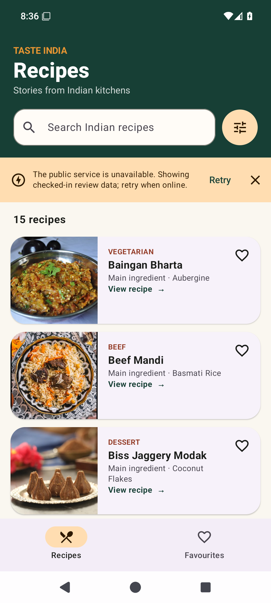
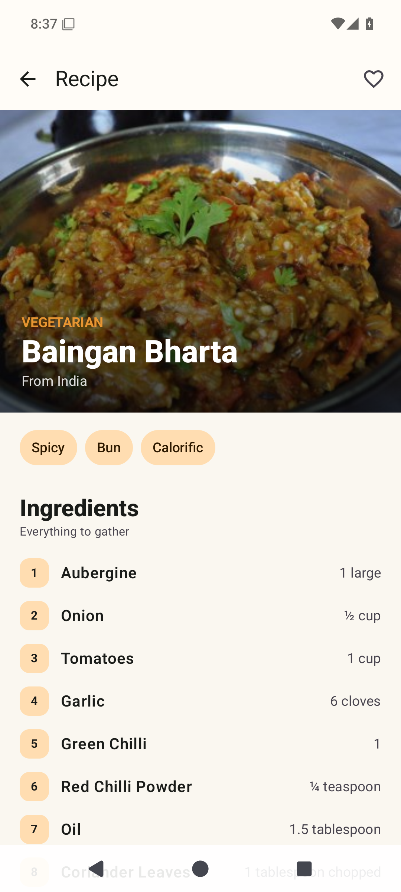
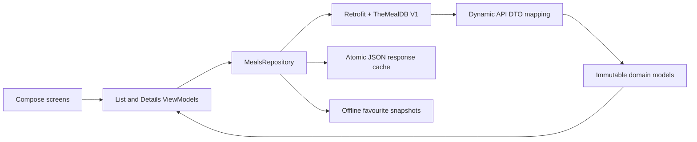

<div align="center">

# TasteIndia

### Discover Indian recipes, cook with confidence, and save favourites offline.

[](https://kotlinlang.org/)
[](https://developer.android.com/compose)
[](https://developer.android.com/)
[](#verification)
[](#verification)

Native Android intern assessment built with Kotlin, Jetpack Compose, Material 3, and TheMealDB.

</div>

| Recipe discovery | Complete recipe details |
| :---: | :---: |
|  |  |

## Highlights

- Browse the authoritative TheMealDB India collection with stable meal IDs.
- Search by meal name and combine category, main ingredient, and favourites filters.
- Sort recipes A-Z or Z-A and remove active filters individually.
- Read complete details: hero image, category, area, ingredients, measures, instructions, tags, source, video, and additional meaningful fields.
- Add or remove favourites from either screen and keep them across relaunches.
- Restore search, filters, sort order, and list position after opening details.
- Continue browsing during provider outages with checked-in fixtures and food thumbnails.
- Handle loading, timeout, offline, empty, partial-data, image-failure, and retry states deliberately.
- Support light/dark appearance, font scaling, screen readers, and descriptive controls.

## Quick start

### Android Studio

Requirements: JDK 17 and Android Studio with Android SDK 35. No API key or account is required.

1. Clone the repository and open it in Android Studio.
2. Allow Gradle sync to finish.
3. Select an API 26+ emulator or connected device.
4. Run the `app` configuration.

### Windows terminal

```powershell
git clone https://github.com/Gideon-sam/Zoomcars-TasteIndia.git
cd Zoomcars-TasteIndia
python tools\bootstrap.py
.\gradlew.bat testDebugUnitTest assembleDebug
```

`bootstrap.py` installs the pinned Gradle 8.9 and Android SDK 35 packages inside `.tools`. `gradlew.bat` reuses that local Gradle installation, so it does not download a second distribution.

The debug APK is generated at:

```text
app/build/outputs/apk/debug/app-debug.apk
```

### Keep build files off the C drive

The Windows wrapper defaults `GRADLE_USER_HOME` to `.gradle-user-home` inside the repository. With this project at `D:\Zoomcars`, Gradle dependencies, the SDK, emulator image, and build outputs stay on `D:`.

In Android Studio, set:

```text
Settings > Build, Execution, Deployment > Build Tools > Gradle
Gradle user home: D:\Zoomcars\.gradle-user-home
```

Use the SDK path written to `local.properties`:

```text
D:\Zoomcars\.tools\android-sdk
```

## Architecture



The project uses small, replaceable boundaries instead of a large framework:

- `data`: Retrofit service, DTO mapping, request orchestration, deduplication, and file persistence.
- `domain`: immutable models, URL validation, ingredient normalization, and pure filter intersection.
- `ui`: separate lifecycle-aware list/detail ViewModels and reusable Compose components.
- `AppContainer`: supplies replaceable repository and persistence dependencies.

UI state is exposed as immutable `StateFlow`. Navigation passes only `idMeal` through these routes:

```text
recipes
favourites
details/{mealId}
```

## API strategy

TasteIndia uses only the documented public TheMealDB V1 API:

```text
filter.php?a=Indian
filter.php?a=India
lookup.php?i={mealId}
```

The provider currently uses both `Indian` and `India` during an area-label transition. The app requests both labels concurrently and treats the larger valid area response as the authoritative ID boundary. The checked-in fixture captured 15 valid India records on 27 October 2026.

Detail enrichment is bounded to four concurrent requests, deduplicated per ID, and cached. Category and main-ingredient filters use cached details and intersect their IDs with the authoritative India set. This prevents a category or ingredient result from introducing a non-India meal.

The 20 ingredient and measure fields are converted into ordered `Ingredient` values. Empty ingredients, malformed URLs, raw JSON keys, and blank labels are omitted. Meaningful new V1 fields are preserved in the details screen.

## Offline and reliability behavior

- Successful collections are stored in `cache.json`.
- Favourite recipe snapshots are stored independently in `favourites.json`.
- Temporary and backup files protect writes from partial replacement.
- Network calls have explicit connect, read, and call timeouts.
- HTTP failures and timeouts become readable retry states.
- Checked-in JSON fixtures and 500px provider thumbnails keep review flows usable offline.
- Fixture-backed screens remain visibly labelled and are never presented as live data.
- Coroutine cancellation is preserved rather than converted into an error state.

## Verification

Run all local checks with:

```powershell
.\gradlew.bat testDebugUnitTest assembleDebug lintDebug
```

Current result:

| Check | Result |
| --- | --- |
| Unit tests | 8 passed, 0 failed |
| Android lint | 0 errors |
| Debug APK | Built successfully |
| Emulator review | Android 15 light/dark, list, filters, details, favourites, relaunch |

Focused tests protect:

- API serialization and ingredient/measure normalization;
- strict India-boundary filter intersection;
- rapid-query latest-state behavior;
- filter and sort restoration through `SavedStateHandle`;
- favourite persistence without network access;
- safe URL and blank-field handling.

## Toolchain

| Component | Version |
| --- | --- |
| Kotlin | 2.0.21 |
| Android Gradle Plugin | 8.7.3 |
| Gradle | 8.9 |
| Compose BOM | 2024.12.01 |
| Java | 17 |
| minSdk | 26 |
| targetSdk / compileSdk | 35 |

## Design and accessibility

The interface uses a branded forest, saffron, and ivory palette with a coordinated dark theme. Material touch targets, scalable typography, explicit selected states, live result-count semantics, non-redundant image descriptions, and descriptive favourite/link actions support accessible use. The UI does not rely on colour alone.

## Demo checklist

For the required 2-4 minute assessment recording, show:

1. Initial recipe loading and the 15-recipe collection.
2. Search plus combined category and ingredient filters.
3. A-Z and Z-A sorting, result count, active filters, and Clear all.
4. Complete recipe details and safe source/video actions.
5. Adding and removing a favourite from list and details.
6. The Favourites destination and relaunch persistence.
7. Back navigation restoring filters and scroll position.
8. Error/retry or offline-fixture behavior.
9. The offline unit-test command completing successfully.

## Attribution and usage

Recipe text, metadata, fixtures, remote images, and checked-in fallback thumbnails are provided by [TheMealDB](https://www.themealdb.com/api.php). Test key `1` is permitted for educational development. The provider requires a paid subscription for app-store publication, so this assessment build is not intended for public release.

AndroidX, Jetpack Compose, Retrofit, OkHttp, Kotlin Serialization, Kotlin Coroutines, and Coil are used under their respective open-source licences.

## AI assistance and candidate ownership

OpenAI Codex materially assisted the initial architecture, Compose implementation, tests, fixture capture, debugging, and documentation. The candidate must review every file, run and understand the tests, record their actual review/modification time, and be able to explain or change the implementation before submission.

This disclosure is intentional: the assignment requires candidate ownership and does not accept unreviewed autonomous output.

